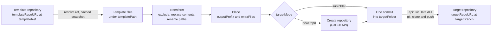

# Git Repo Scaffolder Activity


Generates a project from a **template folder in a Git repository** and publishes it as **one commit**, either into a folder of a shared repository or into a new repository. On the way, a token → value map is applied to file contents and to file and folder names. Pure Go ([go-git](https://github.com/go-git/go-git) and the GitHub REST API): no `git` CLI and no working directory on disk.

Typical uses: scaffold a new integration or service from a template library, keep a generated folder in sync with its template, add generated files (configuration, CI/CD, schemas) to an existing folder, or remove a generated folder again.

Supports:
- Two target modes — `subfolder` (a folder of an existing, shared repository) and `newRepo` (the repository is created through the GitHub API, for a user or an organisation)
- Two write strategies — the GitHub **Git Data API** (no clone, only changed files are sent) or **git over HTTPS** (shallow in-memory clone and push, any Git host); `auto` picks one per target
- Token replacement — longest token first, `sequential` (cascading) or `singlePass`; tokens can be computed at runtime (`replacementList`)
- Path renaming — per path segment, with collision and path-traversal checks
- Binary-safe — common binary types, files containing NUL bytes and files over `maxTextBytes` are copied byte for byte
- Exclude patterns, an output prefix, and extra generated files written in the same commit
- Idempotent — an identical result creates no commit (`pushed=false`)
- Concurrency-safe — writes to the same branch are serialised within the engine; a race lost to another writer is redone on the new branch tip
- Template cache — snapshots keyed by the template commit; a repeat call costs one ref listing
- Dry run — fetch and transform only

**Status**: ✅ Active
**Category**: `gitreposcaffolder`

---

## How it works



1. **Fetch** — resolves `templateRef` (branch, tag, or the default branch) on `templateRepoURL` and reads the files under `templatePath` from an in-memory snapshot of that commit. Symlinks and submodules are skipped; the executable bit is kept.
2. **Transform** — leaves out excluded files, replaces tokens in text files and renames paths.
3. **Place** — puts the output under `outputPrefix` and adds `extraFiles`.
4. **Create** (`newRepo` only) — creates the repository if it does not exist.
5. **Write** — one commit on `targetBranch`. With `cleanTargetFolder` the folder's content is replaced (files the template no longer produces are deleted); otherwise files are added or updated.

---

## Target modes

| | `subfolder` | `newRepo` |
|---|---|---|
| Writes into | `targetFolder` of an existing repository | a repository created for the project (an existing one is reused with `failIfRepoExists=false`) |
| `targetFolder` | required, so a mapping error cannot replace a whole shared repository | optional; empty = repository root |
| Repository creation | — | GitHub API: `POST /user/repos` when the owner is the token's user, `POST /orgs/{owner}/repos` otherwise; `newRepoPrivate`, `newRepoDescription` |
| Branch | must exist (in an empty repository the first commit creates it) | created by the first commit and set as the default branch |
| Git hosts | any Git host that accepts a token as the HTTPS password (`git` strategy) | GitHub and GitHub Enterprise |

---

## Write strategies

| `writeStrategy` | How | Use for |
|---|---|---|
| `api` | GitHub Git Data API: reads the branch, lists only the target folder, uploads the changed files, creates tree and commit, moves the branch without force | GitHub and GitHub Enterprise; cost does not grow with the size of the target repository |
| `git` | Shallow (depth 1) in-memory clone of the target branch, commit, push | any Git host over HTTPS |
| `auto` (default) | `api` for `github.com` or when `apiBaseURL` differs from its default, `git` otherwise. Falls back to `git` when the API cannot do the write (empty repository, folder listing truncated by the API) | |

The `writeMode` output reports which one was used.

---

## Inputs

The activity has no settings: everything is an input, so one activity can serve different templates and targets per call. Unmapped inputs use the defaults below at runtime as well; an empty string, or a number ≤ 0, also means "use the default".

### Authentication

| Input | Type | Default | Description |
|-------|------|---------|-------------|
| `authToken` | string | — | Token for the target repository (git over HTTPS and the GitHub API) and, unless `templateAuthToken` is set, for the template. Map it from a secret app property. |
| `templateAuthToken` | string | — | Separate token for reading the template repository, e.g. a read-only one. |

### Template

| Input | Type | Default | Description |
|-------|------|---------|-------------|
| `templateRepoURL` | string, required | — | Clone URL of the template repository (HTTPS; `file://` works for local tests). |
| `templateRef` | string | default branch | Branch or tag to read. |
| `templatePath` | string | whole repository | Folder used as the template root; output paths are relative to it. |

### Replacement

| Input | Type | Default | Description |
|-------|------|---------|-------------|
| `replacements` | object | — | Token → value map, applied to text file contents and to file and folder names. |
| `replacementList` | array of `{token, value}` | — | Same as `replacements`, for tokens computed at runtime (e.g. `<templateName>.module`); overrides `replacements` entries with the same token. |
| `ignoreEmptyValues` | boolean | `false` | Skip tokens whose value is empty instead of replacing them with an empty string. |
| `replacementMode` | `sequential` or `singlePass` | `sequential` | See [Token replacement](#token-replacement). |
| `renamePaths` | boolean | `true` | Also apply the replacements to file and folder names. |
| `excludePatterns` | array of string | — | Template files to leave out, see [Exclude patterns](#exclude-patterns). |
| `binaryExtensions` | array of string | — | Extra extensions (`.dat` or `dat`) copied without replacement. |
| `maxTextBytes` | integer | `5242880` (5 MiB) | Larger files are copied without replacement. |

### Output layout

| Input | Type | Default | Description |
|-------|------|---------|-------------|
| `outputPrefix` | string | — | Sub-path inside the target folder for the template output, e.g. `code/<name>`. |
| `extraFiles` | array of `{path, content}` | — | Generated text files written in the same commit. Paths are relative to the target folder (not to `outputPrefix`); the content is not token-replaced; a file replaces template output at the same path. |

### Target

| Input | Type | Default | Description |
|-------|------|---------|-------------|
| `targetMode` | `subfolder` or `newRepo`, required | `subfolder` | See [Target modes](#target-modes). |
| `targetRepoURL` | string, required | — | `https://host/owner/name` (`.git` optional). May be empty with `dryRun`. |
| `targetBranch` | string | `main` | Branch to commit to. |
| `targetFolder` | string | — | Folder in the target repository; required in `subfolder` mode. |
| `cleanTargetFolder` | boolean | `true` | Delete the folder's existing files first, so files the template no longer produces disappear. `false` = add and update only. |
| `newRepoPrivate` | boolean | `true` | `newRepo`: create the repository as private. |
| `newRepoDescription` | string | — | `newRepo`: repository description. |
| `failIfRepoExists` | boolean | `true` | `newRepo`: fail with `GITSCAFFOLD-4005` when the repository exists; `false` = write into it. |
| `apiBaseURL` | string | `https://api.github.com` | GitHub API base URL; GitHub Enterprise: `https://<host>/api/v3`. |

### Commit and execution

| Input | Type | Default | Description |
|-------|------|---------|-------------|
| `commitMessage` | string | `Scaffold from template` | Commit message. |
| `authorName` | string | `Flogo Git Repo Scaffolder` | Commit author and committer name. |
| `authorEmail` | string | `git-repo-scaffolder@flogo.local` | Commit author and committer e-mail. |
| `writeStrategy` | `auto`, `api` or `git` | `auto` | See [Write strategies](#write-strategies). |
| `pushRetries` | integer | `3` | Attempts when another writer moves the branch at the same time. |
| `dryRun` | boolean | `false` | Fetch and transform only; nothing is created or pushed. The outputs still list the files. |
| `timeoutSeconds` | integer | `120` | Overall timeout of the activity. |

---

## Outputs

| Output | Type | Description |
|--------|------|-------------|
| `repoURL` | string | Web URL of the target repository. |
| `folderURL` | string | Web URL of the target folder (`…/tree/<branch>/<folder>`), or of the repository. |
| `branch` | string | Branch written to. |
| `commitSHA` | string | The new commit; the current branch tip when nothing changed. |
| `templateCommit` | string | Template commit that was used. |
| `pushed` | boolean | `false` when the result equals the repository content (no commit is made) or in a dry run. |
| `writeMode` | string | `api` or `git`; empty in a dry run. |
| `repoCreated` | boolean | `newRepo`: the repository was created by this call. |
| `filesTotal` | integer | Files written: template output and extra files. |
| `filesModified` | integer | Template files whose content changed through replacements. |
| `pathsRenamed` | integer | Template files whose path changed. |
| `filesExcluded` | integer | Template files left out by `excludePatterns`. |
| `files` | array of string | Paths of the written files inside the target repository. |
| `durationMs` | integer | Execution time in milliseconds. |

---

## Token replacement

- **Longest token first** — `SystemName_ObjectName` is replaced before its prefix `SystemName`; tokens of equal length are ordered alphabetically, so the result never depends on map order.
- **`sequential`** (default) — tokens are applied one after another, each to the result of the previous one, so a value may produce another token: with `{"Name.Inbound": "Name.Outbound", "Name": "s4hana"}`, `Name.Inbound` becomes `s4hana.Outbound`.
- **`singlePass`** — one scan; replaced text is never matched again: the same example gives `Name.Outbound`.
- **Paths** — each path segment is renamed on its own, so a token never spans a `/`; tokens containing `/` or `\` apply to contents only. A rename that produces an empty, `.` or `..` segment, or two files with the same path, fails with `GITSCAFFOLD-4003`.
- **Binary files** are renamed but never changed: the extensions below plus `binaryExtensions`, files with a NUL byte in their first 8 KiB, and files larger than `maxTextBytes`.
  Default binary extensions: `.jar .war .ear .zip .gz .tgz .bz2 .7z .xz .tar .class .png .jpg .jpeg .gif .bmp .ico .webp .svgz .pdf .so .dll .exe .bin .dylib .keystore .jks .p12 .pfx .woff .woff2 .ttf .eot .otf`
- **`ignoreEmptyValues`** drops tokens with an empty value (from `replacements` and `replacementList`), so an optional field leaves the template text in place.

---

## Exclude patterns

Patterns are matched against the template paths, relative to `templatePath` and before renaming:

| Pattern | Matches |
|---------|---------|
| `name`, `*.ext` | a file name at any depth, e.g. `.DS_Store`, `*.bak` |
| `dir/` | a directory and everything below it, at any depth, e.g. `target/` |
| `a/b/*.x` | the full relative path |
| `**/a/*.x` | any trailing part of the path |
| `*` | every template file; used to write only `extraFiles` or to delete a folder, see [Recipes](#recipes) |

---

## Behaviour and guarantees

- **One commit per call** — template output, extra files and deletions land together; a failed call leaves the branch unchanged. In `newRepo` mode the repository is created before the write, so after a failed write an empty repository remains (a re-run with `failIfRepoExists=false` writes into it).
- **Idempotent** — when the result equals what is on the branch, no commit is made: `pushed=false` and `commitSHA` is the current tip.
- **Concurrency** — calls in one engine that write to the same repository and branch run one after another. If another writer moves the branch between read and update, the write is redone on the new tip, up to `pushRetries` attempts, then `GITSCAFFOLD-4007`. The branch is never force-updated.
- **Template cache** — per template URL and ref, keyed by the resolved commit: an unchanged template costs one ref listing, a new commit is fetched once. Up to 8 snapshots are kept in memory.
- **Default branch** — a repository created by the activity gets `targetBranch` as its default branch after the first commit (otherwise it would keep the account's default branch name).
- **Empty repositories** — the Git Data API cannot write into an empty repository, so the first commit goes through git; `auto` does this automatically.

---

## Error codes

Errors reach the flow's error handler with `$error.code`:

| Code | Cause |
|------|-------|
| `GITSCAFFOLD-4001` | Invalid input: missing `templateRepoURL`, unknown `targetMode` or `writeStrategy`, malformed `targetRepoURL`, `subfolder` mode without `targetFolder`, empty `targetBranch`, absolute or `..` paths in `outputPrefix` or `extraFiles`, an input of the wrong type |
| `GITSCAFFOLD-4002` | Template: repository unreachable or empty, ref not found, no files under `templatePath` |
| `GITSCAFFOLD-4003` | Transform: unknown `replacementMode`, rename collision or invalid renamed path |
| `GITSCAFFOLD-4004` | `newRepo`: the repository could not be checked or created (permissions, API error) |
| `GITSCAFFOLD-4005` | `newRepo`: the repository already exists and `failIfRepoExists` is `true` |
| `GITSCAFFOLD-4006` | Write failed: authentication, missing branch, network or API error |
| `GITSCAFFOLD-4007` | The branch kept moving: all `pushRetries` attempts lost the race to another writer |

---

## Security

- Map `authToken` and `templateAuthToken` from **secret** app properties. The token is sent as the HTTPS password for git (user `x-access-token`) and as a Bearer token to the GitHub API; the activity does not log it.
- GitHub token permissions: read access to the template repository and **Contents: write** on the target repositories. Creating repositories (`newRepo`) also needs **Administration: write** (fine-grained token) or the `repo` scope (classic token).
- `newRepoPrivate` defaults to `true`, and unmapped inputs keep their documented defaults at runtime (`defaults_test.go` checks the runtime defaults against `descriptor.json`).
- `subfolder` mode refuses an empty `targetFolder`; `outputPrefix` and `extraFiles` paths cannot be absolute or contain `..`.

---

## Recipes

| Goal | Inputs |
|------|--------|
| Project in a folder of a shared repository | `targetMode=subfolder`, `targetFolder=<name>`, `cleanTargetFolder=true` |
| Repository per project | `targetMode=newRepo`, `targetRepoURL=https://github.com/<owner>/<name>` |
| Add or update files in an existing folder | `excludePatterns=["*"]`, `extraFiles=[{path, content}, …]`, `cleanTargetFolder=false` |
| Delete a generated folder | `excludePatterns=["*"]`, no `extraFiles`, `cleanTargetFolder=true`: one commit that removes the folder |
| Preview | `dryRun=true`: `files`, `filesModified` and `pathsRenamed` without writing |

With `excludePatterns=["*"]` the template is still read (from the cache), so `templateRepoURL` must point to a readable repository.

---

## Example

Generate a project from the `templates/KAFKATopic_To_REST_SERVICE` template into a folder of a shared repository:

| Input | Value |
|-------|-------|
| `authToken` | `=$property["GITHUB_TOKEN"]` |
| `templateRepoURL` | `https://github.com/acme/templates` |
| `templatePath` | `templates/KAFKATopic_To_REST_SERVICE` |
| `replacements` | `{"KAFKATopic_To_REST_SERVICE": "s4hana-article-kafka-pub", "SystemName": "s4hana", "ObjectName": "article"}` |
| `excludePatterns` | `[".DS_Store", "catalog-info.yaml"]` |
| `targetMode` | `subfolder` |
| `targetRepoURL` | `https://github.com/acme/integrations` |
| `targetFolder` | `s4hana-article-kafka-pub` |
| `commitMessage` | `Generate s4hana-article-kafka-pub` |

The template file `KAFKATopic_To_REST_SERVICE.module/Processes/SystemName_ObjectName_Sub.bwp` is committed as `s4hana-article-kafka-pub/s4hana-article-kafka-pub.module/Processes/s4hana_article_Sub.bwp`, with the tokens in its content replaced as well. Running the activity again with the same inputs makes no commit (`pushed=false`).

The [BWCE AI Generator](https://github.com/mpandav-tibco/ai-template-generator) Flogo app uses this activity to publish generated BWCE projects in both target modes, to add uploaded schema files (`extraFiles` only) and to delete generated folders.

---

## Running Tests

```bash
cd activity/gitreposcaffolder
go test ./...            # unit tests: local bare repositories (file://) and a mock GitHub API, no network required
go vet ./... && gofmt -l .

# live test against GitHub; creates private test repositories under GITHUB_OWNER
GITHUB_TOKEN=... GITHUB_OWNER=... go test -tags integration -run Live -v ./...
```

---

## Build

A separate Go module (`github.com/mpandav-tibco/flogo-custom-extensions/activity/gitreposcaffolder`, Go 1.23+, go-git v5.16), compiled into a Flogo app through the standard user-extension build like the other custom extensions in this repository.

> **Build note:** the descriptor's `display.category` (`gitreposcaffolder`) must match this directory's basename. The Flogo build derives the app's extension-registry entry from the category and resolves it to a directory of that name under the user-extensions path (`-e`); a mismatch causes a misleading `"the following extensions <category> do not contain a go.mod file"` error.
